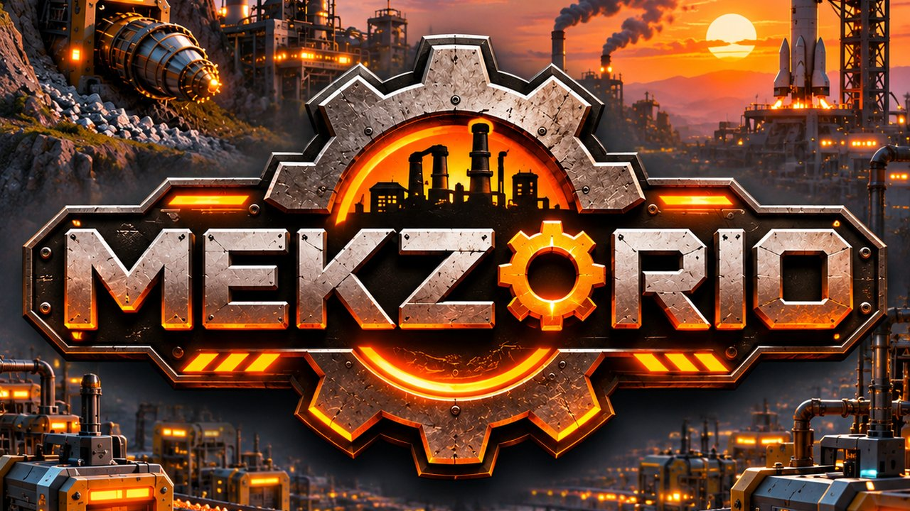
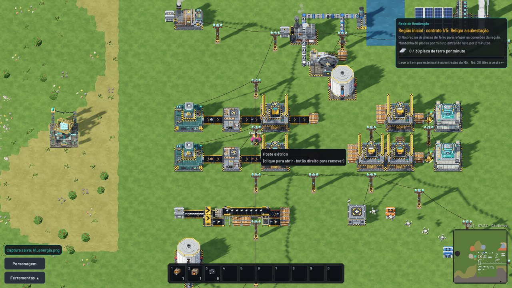
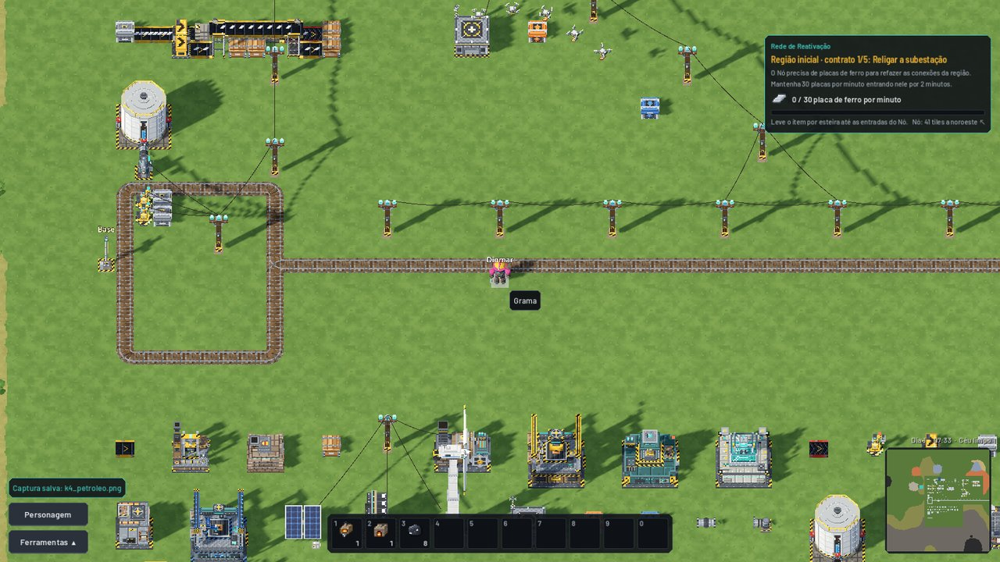
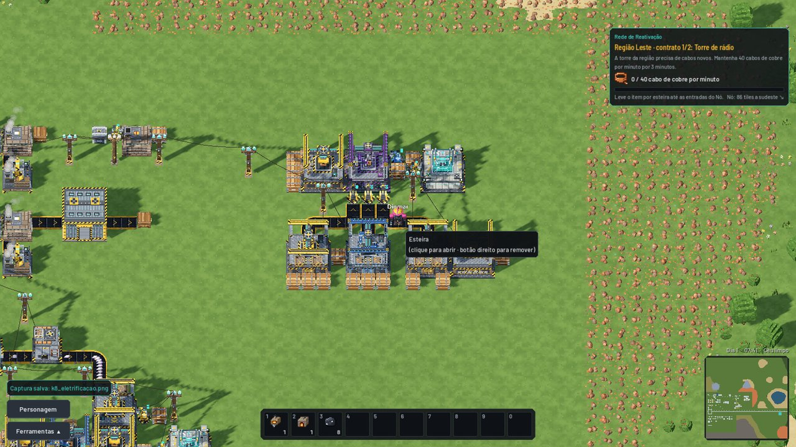
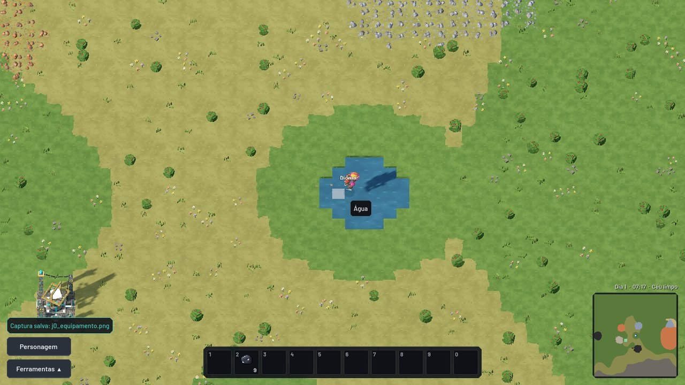

# MEKZORIO — versões de teste (alfa)

Jogo de automação industrial para PC (Windows e Linux), com multijogador cooperativo e mods.
Comece coletando à mão e termine com fábricas inteiras ligadas por esteiras, canos, trens e drones.

**Site do jogo:** [diomargoncalves.github.io/mekzorio-versoes](https://diomargoncalves.github.io/mekzorio-versoes/)

> **Versão alfa:** o jogo está em desenvolvimento e pode ter erros. Este repositório só tem as versões para
> baixar; o código do jogo não é público.

## Baixar

Abra **[Releases](../../releases/latest)** e baixe o arquivo do seu sistema:

| Arquivo | Para quê |
|---|---|
| `Mekzorio-jogo-windows.zip` | Jogar no Windows (10 ou 11, 64 bits) |
| `Mekzorio-jogo-linux.zip` | Jogar no Linux (64 bits) |
| `Mekzorio-servidor-linux.zip` | Servidor dedicado para Linux (qualquer distribuição) |
| `Mekzorio-servidor-linux-alpine.zip` | Servidor dedicado para Alpine Linux |
| `Mekzorio-egg-pterodactyl.json` | Egg para hospedar o servidor num painel Pterodactyl |
| `mekzorio_amd64.deb` (e `Packages`, `Release`) | Instalar no Linux pelo apt (veja abaixo) |

**Como abrir:** extraia o `.zip` inteiro (não abra de dentro do `.zip`) e abra o `Mekzorio.exe` (Windows) ou
o `Mekzorio.x86_64` (Linux). No Windows, se aparecer "O Windows protegeu o computador", clique em
**Mais informações → Executar assim mesmo** (acontece com todo jogo que ainda não tem assinatura digital).
O `LEIA-ME.txt` de cada pacote explica o resto.

### Linux com apt (Ubuntu, Debian, Mint, Pop!_OS…) — a partir da v0.1.8-alfa

Instale uma vez e as versões novas chegam junto com as atualizações do sistema:

```bash
echo "deb [trusted=yes] https://github.com/DiomarGoncalves/mekzorio-versoes/releases/latest/download ./" | sudo tee /etc/apt/sources.list.d/mekzorio.list
sudo apt update && sudo apt install mekzorio
```

Depois é só abrir o **MEKZORIO** no menu de aplicativos (ou `mekzorio` no terminal). Para atualizar:
`sudo apt update && sudo apt upgrade`. Para tirar: `sudo apt remove mekzorio` (seus mundos ficam em
`~/.local/share/MEKZORIO`). O `trusted=yes` existe porque o repositório ainda não tem assinatura própria: o download
vem direto das Releases deste repositório no GitHub, por HTTPS.

## Requisitos

**Jogo**

| | Mínimo | Recomendado |
|---|---|---|
| Sistema | Windows 10/11 ou Linux, 64 bits | — |
| Processador | 2 núcleos | 4 núcleos |
| Memória | 4 GB | 8 GB |
| Placa de vídeo | OpenGL 3.3 (quase todas desde 2012) | Com Vulkan (NVIDIA GTX 600+, AMD HD 7000+, Intel HD 500+) |
| Disco | 500 MB | — |

**Servidor dedicado**

| | Mínimo | Recomendado |
|---|---|---|
| Sistema | Linux 64 bits (x86-64), qualquer distribuição; ARM não é suportado | — |
| Processador | 1 núcleo | 2 núcleos |
| Memória | 512 MB | 1 GB |
| Disco | 300 MB + mundos | 1 GB |
| Rede | Porta **UDP** liberada (padrão 27777) | — |

**PC fraco:** Opções → Gráficos → Qualidade **Baixa**; se ainda travar, ligue **Modo leve (OpenGL)** e abra o jogo de
novo. Sem Vulkan, o jogo abre sozinho no modo leve.

Valores medidos na alfa (servidor com uma fábrica grande: ~75 MB de memória e ~6% de um núcleo); ainda não
testados em PCs fracos.

## Jogar com amigos

- **Pelo próprio jogo:** quem hospeda abre um mundo, aperta Esc e escolhe **Abrir para a rede**. Os outros entram
  em **Multijogador → Entrar por endereço** (IP:porta; a porta padrão é 27777, UDP).
- **Servidor dedicado** (fica ligado sem ninguém jogando): use o `Mekzorio-servidor-linux.zip`. Para painel
  Pterodactyl, importe o egg (sempre a versão mais nova em [pterodactyl/egg-mekzorio.json](pterodactyl/egg-mekzorio.json));
  o passo a passo está em [pterodactyl/LEIA-ME.md](pterodactyl/LEIA-ME.md). O servidor usa a porta **UDP** 27777.
- Todos precisam usar a **mesma versão** do jogo e do servidor.

## Imagens

| | |
|---|---|
|  |  |
|  |  |

## Achou um erro?

Abra uma **[Issue](../../issues/new/choose)** contando o que aconteceu, o que você estava fazendo e, se der, com
uma foto da tela. As novidades de cada versão ficam em [NOVIDADES.md](NOVIDADES.md).

---

MEKZORIO © DiomarGoncalves. Todos os direitos reservados. Veja os [termos de uso](TERMOS.md).
